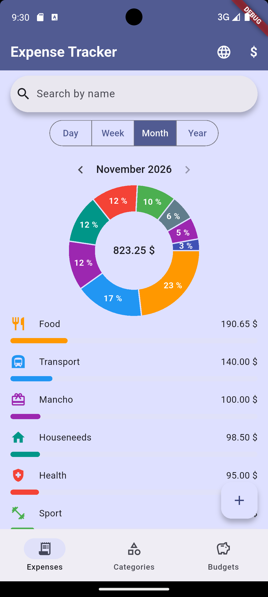
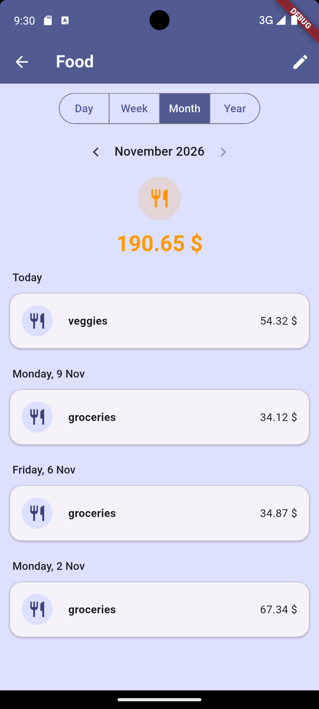
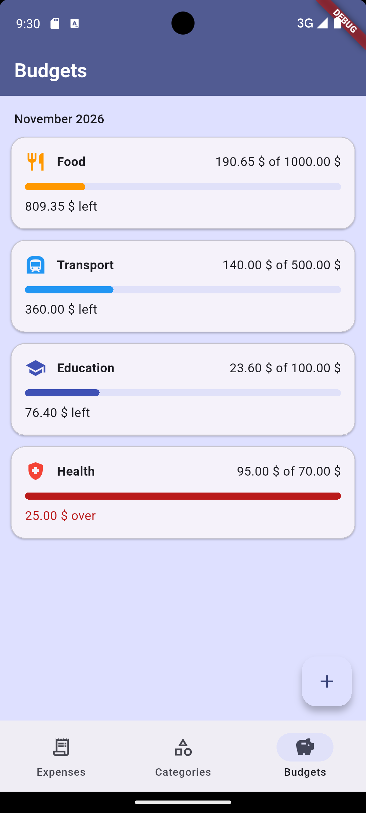
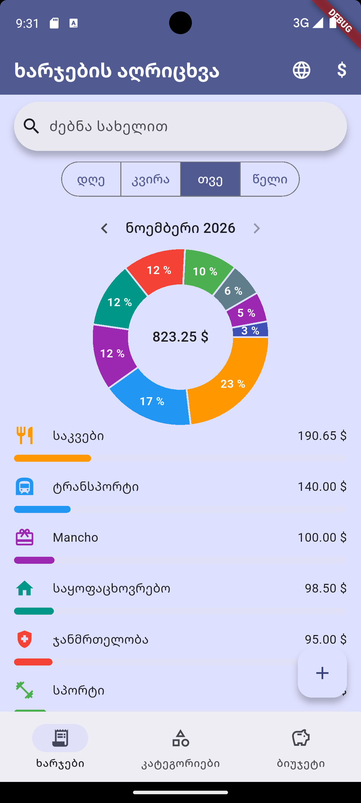
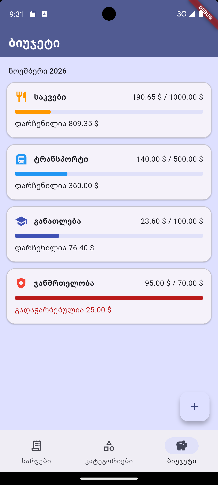

# Expense Tracker

A Flutter app for tracking daily expenses. I built it while learning Flutter and kept improving it step by step: periods, categories, budgets, currency and a Georgian translation.

## Screenshots

<p>
  
  
  
</p>

The app also works in Georgian:

<p>
  
  
</p>

## What it can do

- Add, edit and delete expenses. After deleting you can undo it from the snackbar.
- Look at expenses by day, week, month or year, with arrows to go to the previous period.
- A donut chart that shows how the total is split between categories.
- Search expenses by name across all periods.
- Create, edit and delete your own categories with an icon and a color. The default ones are translated, the ones you create or rename keep your own name.
- A page for each category with its total and its expenses grouped by date.
- Monthly budgets per category. The card shows how much is left, and turns red when the limit is passed.
- Switch the currency between $, € and ₾.
- English and Georgian. The chosen language and currency are saved on the phone.

## Built with

- Flutter and Dart
- Riverpod for state management
- sqflite for the local database
- fl_chart for the donut chart
- shared_preferences for the language and currency
- intl and flutter_localizations for the translations and dates

## How it works

- Money is stored in cents as integers, so there are no rounding problems with decimals.
- The database has versions and migrations. The categories and budgets were added later, and old data is moved to the new tables without losing anything.
- Deleted categories are only marked as deleted, so old expenses still know their category.
- Texts live in two ARB files (`lib/l10n`), and Flutter generates the code from them.
- Logic that does not need the UI (periods, grouping by date, budget progress, category names) is in small functions and has unit tests.

## Run it

You need Flutter installed.

```
flutter pub get
flutter run
```

Run the tests:

```
flutter test
```

## What I learned

- Changing an app that already has data: database migrations and why you must not break old data.
- Splitting a big screen into small widgets and providers.
- Writing tests for the logic first, so changes feel safe.
- Translating an app, including dates, texts with values inside, and names stored in the database.
- Working with git in small steps: a branch and a pull request for every feature.