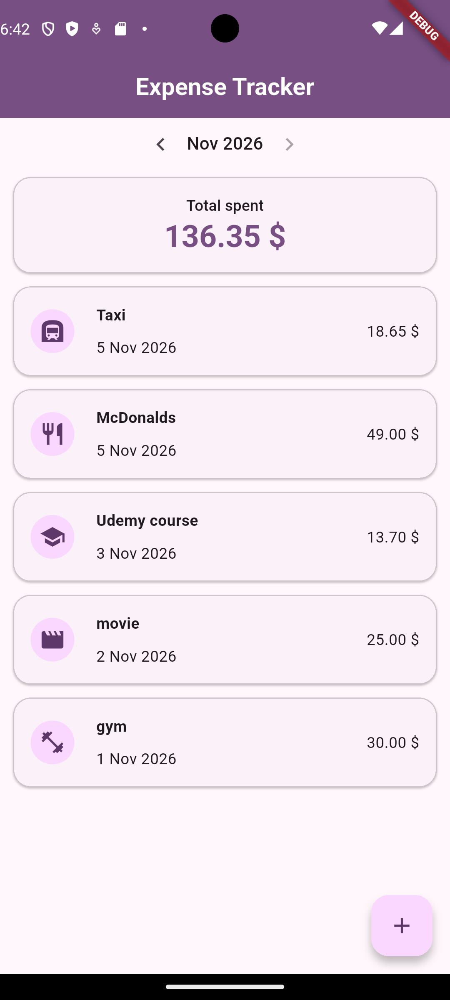
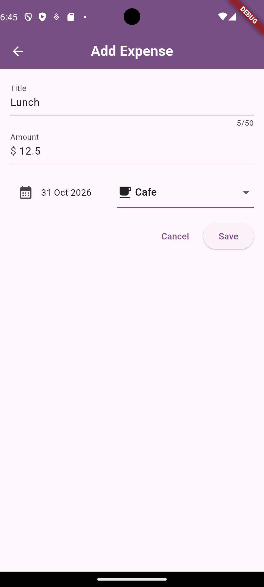
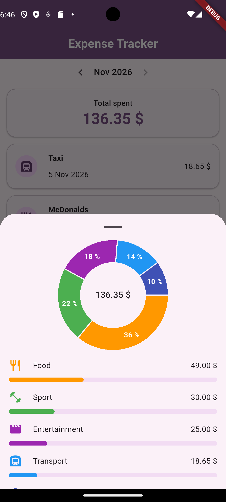
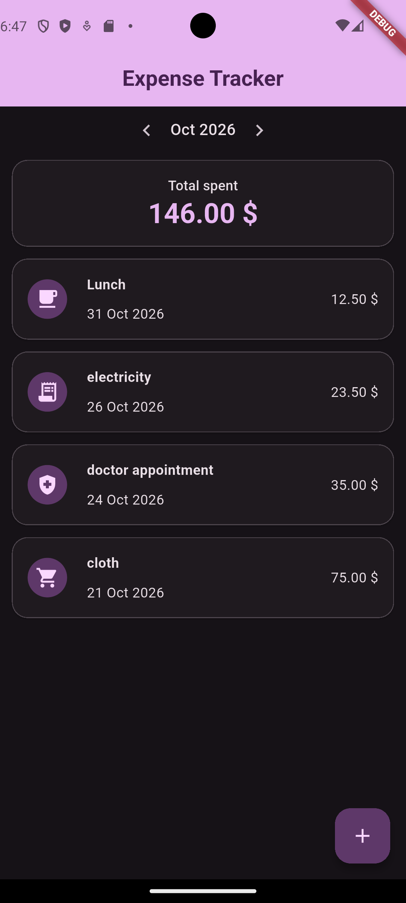

# Expense Tracker

A simple expense tracker app made with Flutter. You add your expenses, see how much you spent each month and where the money went.

## Screenshots

   

## Features

- Add, edit and delete expenses
- Swipe an expense to delete it (it asks to confirm first)
- Switch between months
- Total spent for the selected month
- Tap the total to see spending by category with a chart
- Light and dark theme
- Everything is saved on the phone, so nothing is lost after closing the app

## Tech Stack

- Flutter and Dart
- Riverpod for state management
- sqflite for the local database
- fl_chart for the pie chart
- intl for date formatting

## Project Structure

```
lib/
  main.dart
  database/
    expenses_database.dart     sqflite queries
  models/
    expense.dart               Expense and ExpenseCategory
  providers/
    expenses_provider.dart     expenses list (add, edit, delete)
    month_provider.dart        selected month, totals, categories
  screens/
    home_screen.dart
    add_expense_screen.dart    used for adding and editing
  theme/
    app_theme.dart             light and dark theme
  utils/
    format.dart
  widgets/
    expense_item.dart
    month_selector.dart
    month_summary.dart
    category_breakdown.dart
```

## Notes

- Money is stored as cents (an `int`) so there are no rounding problems with decimals.
- Month total and category totals are calculated from the expenses list with Riverpod providers, so they update by themselves when something changes.

## Getting Started

flutter pub get
flutter run